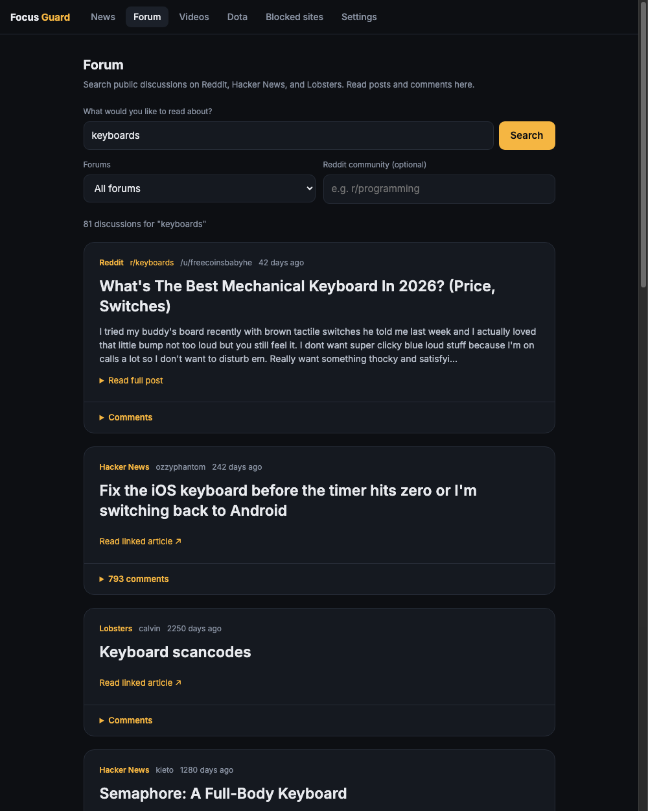
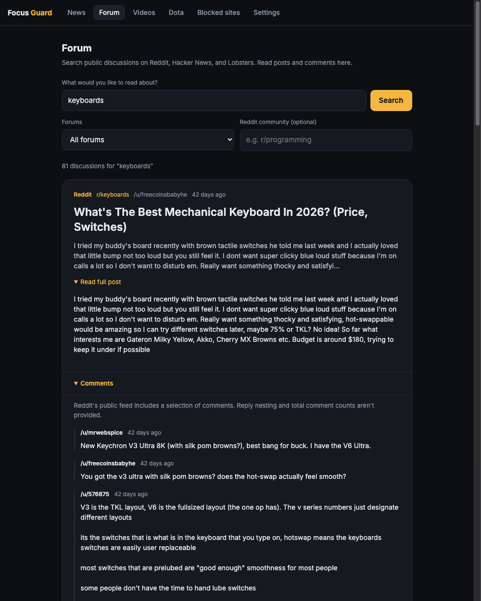
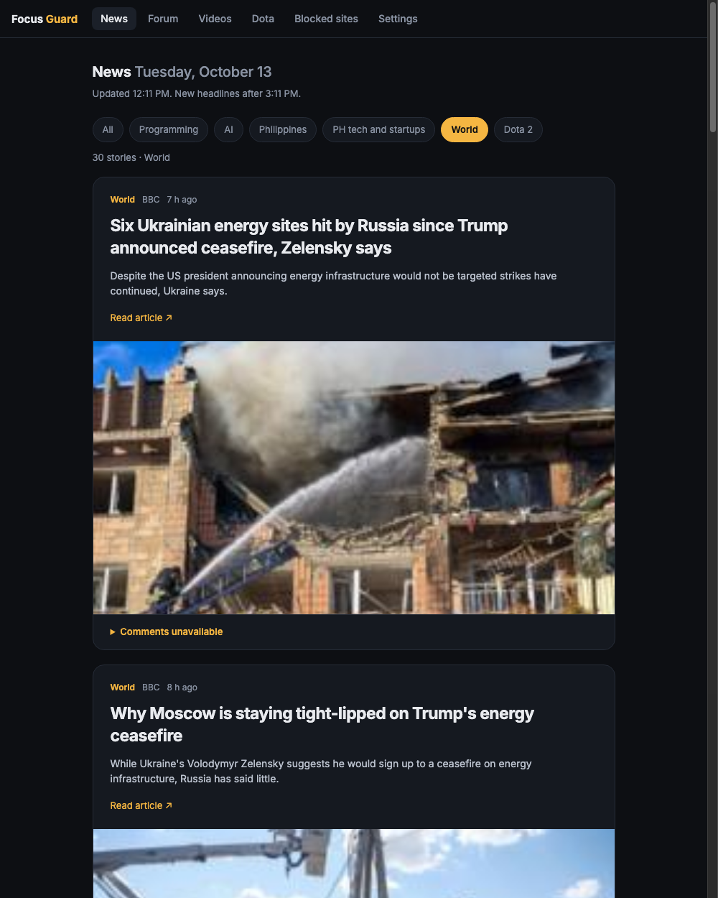

# Focus Guard

[](https://github.com/ReidoBoss/focus-guard/actions/workflows/test.yml)

Self-control tools for people who want to get better at life.



- **Dota Limit**: one best-of-3 Dota 2 series per day. When the series is decided (2-0, 0-2, or after game 3), Steam is closed and stays closed until 4 AM. Saturday and Sunday can have their own limit, like 7 games. Comes with a stats page at **http://focus/dota**.
- **Website blocker**: blocks Facebook, YouTube and Reddit, except **facebook.com/messages** and YouTube's embedded player (for the Videos tab), in Brave, Chrome, Edge, Firefox and Chromium. On macOS it can also stop Safari from opening.
- **Adult website block** (optional): blocks porn and other adult sites in every browser and app, and turns on SafeSearch.

Works on **macOS**, **Ubuntu / Debian** and **Windows 10 / 11**.

## Install

Copy one command, paste it, enter your password, and answer a few questions. Press Enter on any question to take the suggested answer.

### macOS and Ubuntu

Open **Terminal** and run:

```bash
sudo bash -c "$(curl -fsSL https://raw.githubusercontent.com/ReidoBoss/focus-guard/main/install.sh)"
```

### Windows

Right-click the Start button, choose **Terminal (Admin)** or **Windows PowerShell (Admin)**, and run:

```powershell
irm https://raw.githubusercontent.com/ReidoBoss/focus-guard/main/install.ps1 | iex
```

### What it asks

```
1. Dota 2 daily limit
Set up the Dota 2 limit? (y/n) [y]:
When should the day end?
  1) Best of 3: stop at 2 wins or 2 losses
  2) After a fixed number of games
Use a different limit on Saturday and Sunday? (y/n) [n]:
What hour does a new day start? (0-23, so a 2 AM game counts toward the night before) [4]:

2. Website blocker
Supported here: Brave (installed), Google Chrome, Microsoft Edge, Firefox
Block these sites in:
  1) Every supported browser, including ones you install later (recommended)
  2) Only the browsers I pick
  3) None, skip the website blocker
What should happen to Safari?          (macOS only)
  1) Leave Safari alone
  2) Stop Safari from opening

3. Adult websites
Block adult websites? (y/n) [n]:

Summary ... Install with these settings? (y/n) [y]:
```

Running the installer again is how you change settings. Your last answers become the suggested ones, and today's games are kept. To skip the questions, add `--yes` (macOS / Ubuntu: put `-- --yes` at the end of the command, Windows: `-Yes`).

### What the installer does

1. Installs Node.js if you don't have it (apt on Ubuntu, winget on Windows).
2. Closes Steam (it asks first), finds Dota 2 in any of your Steam libraries, and adds the `-gamestateintegration` launch option for you.
3. Starts a background service that runs on every boot (launchd, systemd, or a Windows scheduled task).
4. Adds `focus` to your hosts file so the news and stats pages have a real address.
5. Applies the block list to the browsers you picked, as browser policies.
6. If you chose to block adult websites, switches this computer's DNS to the family filter and adds the SafeSearch policies (see below).

### Browser support

| Browser | macOS | Ubuntu | Windows | Facebook Home button fix |
|---|---|---|---|---|
| Brave | yes | yes | yes | yes, with the extension |
| Google Chrome | yes | yes | yes | yes, with the extension |
| Microsoft Edge | yes | yes | yes | yes, with the extension |
| Chromium | | yes | | yes, with the extension |
| Firefox | yes | yes | yes | no, see below |
| Safari | block Safari entirely, or leave it | | | |

**Safari** has no setting for blocking sites by address, so it can't keep facebook.com/messages open while blocking the rest of Facebook. The installer offers to stop Safari from opening instead, so it can't be used to get around the blocker.

**Firefox** gets the block list, so typing or clicking a link to a blocked site fails. But Firefox only runs extensions signed by Mozilla, so the Home-button fix can't be installed there.

**Ubuntu**: policies work with browsers from `.deb` packages and the Firefox and Chromium snaps. Brave and Chrome from Flatpak ignore them.

### Adult website block

There are far too many adult sites for a block list, so this works through DNS, the internet's address book. Your computer's DNS is switched to [Cloudflare for Families](https://one.one.one.one/family/) (`1.1.1.3`), a free service that refuses to look up adult and malware sites. It works in every browser and app, Safari included. On top of that, browser policies:

- turn on SafeSearch in Google, Bing (Edge) and YouTube, so search results don't show explicit images
- turn off each browser's own "secure DNS", which would otherwise skip the filter

On macOS and Windows every network connection (Wi-Fi, Ethernet, a USB adapter) gets the filter, and the service puts it back within a minute if a new connection appears or someone changes it. On Ubuntu it's set through `systemd-resolved`. Your old DNS settings are saved, and saying no on a later run, or uninstalling, puts them back.

What it can't stop: a VPN, iCloud Private Relay in Safari (it uses its own DNS, so turn it off in System Settings > Apple Account > iCloud), or Firefox's SafeSearch (Firefox has no setting for it, but adult sites are still blocked by the DNS filter).

### One manual step: the extension

Facebook is a single-page app: clicking **Home** inside Messages changes the page without a real page load, so a block list alone can't catch it. The extension sends you back to `/messages` when that happens. Browsers don't let installers add extensions, so do this once in each browser:

1. Open the extensions page (`brave://extensions`, `chrome://extensions` or `edge://extensions`) and turn on **Developer mode**.
2. Click **Load unpacked** and pick the folder the installer printed:
   - macOS: `/usr/local/focus-guard/browsers/extension`
   - Ubuntu: `/opt/focus-guard/browsers/extension`
   - Windows: `C:\Program Files\FocusGuard\browsers\extension`
3. Quit the browser fully and open it again.

On macOS there's one more click, also needed for the adult website block: the installer opens **System Settings > General > Device Management**. Double-click **Focus Guard (website blocker)**, press **Install**, then press Enter in the installer. macOS doesn't let scripts install profiles silently.

## Stats page

Open **http://focus/dota** (type the `http://` so your browser doesn't search for it).

- Today's series score and whether Steam is locked
- Every match: hero, win or loss, K/D/A, last hits and denies, GPM, XPM, net worth, items, game length and score, plus OpenDota, Dotabuff and STRATZ links
- History of past days (click a day to see its matches)
- **Teammates and enemies** for every match (click **Show teammates and enemies**)
- **Tilt check**, **lane results** and a **gold graph** on each match
- **Your heroes**, a **counter-pick lookup** for the draft, and a **weekly summary**

The links at the top of the page jump to each section.

### The app at http://focus

Focus Guard's pages share one tab bar: **News**, **Forum**, **Videos**, **Dota** (the stats page), **Blocked sites** (what's blocked, in which browsers, and whether the adult website block is on) and **Settings** (your Dota limit and the installer command to change it). Blocked sites and Settings only show settings. Changing them still takes the installer and your password, so loosening a limit takes a moment to think about.

The screenshots below show example results in a local preview using cached public posts and feeds.

### Forum

**http://focus/forum** searches public discussions on **Reddit**, **Hacker News**, and **Lobsters**. Pick all forums or just one, enter a topic, and browse results in the same scrolling card layout as News. There's no home feed; discussions appear after you search.

- Add a Reddit community such as **r/programming** to narrow a search. Leave the topic empty to browse that community's posts. Click a community name on a result to search there.
- Click a discussion's title to expand its post and comments here. Longer posts have **Read full post**; longer threads have **Show more comments**. Images appear when the source provides them.
- Reddit's public feeds include a selection of comments, without reply nesting or total comment counts. Hacker News and Lobsters show nested replies. If a forum doesn't answer, results from the other selected forums still appear.
- If comments fail temporarily, keep the thread open and Focus Guard retries them. Reddit's rate-limit wait is respected, and reopening a failed thread after the wait tries again.
- Searches, comments, and images are saved for 10 minutes. Reddit searches request 25 posts at a time to keep requests smaller; the other sources read up to 60 results from their current search page or feed. Reddit images load through Focus Guard, so reddit.com and redd.it stay blocked in the browser. Links to blocked sites are left out.
- Forum is for reading public posts and comments. Posting, voting, and signing in aren't supported.

Posts and comments open inside the Forum tab:



### Videos

**http://focus/videos** searches YouTube while youtube.com itself stays blocked. You get a search box and a list of results, and nothing else: no home feed, no Shorts, no recommendations, no comments. Live streams and anything under 2 minutes are left out.

- A video plays in YouTube's privacy-mode player (`youtube-nocookie.com/embed`), the one part of YouTube the blocker lets through. When it ends, YouTube only suggests videos from the same channel.
- Some uploaders turn off playing on other sites. Those videos say they can't play here. Pick another result.
- With the adult website block on, YouTube's Restricted Mode applies to the player too.

### News

**http://focus** is a scrolling news feed for Programming, AI, Philippines, PH tech and startups, World, and Dota 2. Read all topics together, or pick a topic at the top. More stories appear as you scroll, with up to 60 per topic from the current feeds.



- Sources: Hacker News and Lobsters, Simon Willison, The Verge and TechCrunch, Rappler, Inquirer, GMA News and Philstar, Google News (for PH tech and startups), BBC, Al Jazeera and The Guardian, and Steam's Dota 2 announcements.
- Each story has a headline, source, time, and an article preview and larger image when the feed includes them. Headlines link to the article. Links and images from blocked sites are left out.
- Open **Comments** under a Hacker News or Lobsters story to read comments and replies right in the feed. **Show more comments** expands longer threads. Comments load only when opened and are saved for 10 minutes; counts beside stories reflect the last news update. You can also open the full discussion at the source.
- Other publishers may not share their comments. Those stories say when comments aren't available here, and link to the source discussion when the feed includes one.
- It updates at most every 3 hours, so reloading doesn't show anything new. The first visit takes a few seconds while it gets the headlines.

### Your heroes

Your last 90 days from OpenDota, one row per hero: games, win rate, average KDA, GPM, and a trend that compares your win rate in the last 30 days with the 60 before it. At the top: your best and worst hero (10+ games) and the one improving the most. Focus Guard finds your account from Steam's sign-in file, so this works before your first tracked match.

### Tilt check

After a loss, a notification tells you what went wrong and to take a 10 minute break before queueing again. It starts with what Dota reports live (deaths, GPM against your usual on that hero). Once OpenDota parses the replay, the match card adds more, and you get a second notification if the replay finds something new:

- "Lost your lane: 1.5k gold behind Invoker at 10 minutes (-20 last hits)."
- "Your team was 9k gold ahead at 24:00 and still lost."
- "You died 12 times (your teammates averaged 5)."

It doesn't interrupt the last game of the day, because Steam is about to close anyway.

### Lane results and gold graph

Focus Guard asks OpenDota to parse each replay, which usually takes a few minutes. The match card then shows each lane at 10 minutes (who won, by how much gold), how you did against your lane opponent, and your team's gold lead minute by minute.

### Counter-picks

- **On each enemy:** "Beaten by" shows the heroes with the best win rate against them. Heroes you play yourself are highlighted.
- **Counter-pick lookup** (use it during the draft): type an enemy hero to see what beats it, your own record against it, and which of your heroes are good answers.

The win rates come from OpenDota's high-level parsed games, and only pairs with 30+ games count.

### Weekly summary

A section for each week (Monday to Sunday): record, days played, best hero, worst matchup, how many days the limit stopped you, how many times you tried to reopen Steam after it did, and your average KDA. Use **Previous** and **Next** to look at other weeks. When a new week starts, you get a notification about the last one.

### Teammates and enemies

A few minutes after a match ends, Focus Guard looks it up on [OpenDota](https://www.opendota.com), a free public Dota 2 stats site, and shows all 10 players:

- Name, rank medal, estimated MMR, total games and win rate, and their last 10 results
- Their 3 most-played heroes with games and win rate, with the hero they played this match highlighted
- This match: K/D/A, net worth, GPM/XPM, hero damage, level and items

Plus quick labels:

| Label | Means |
|---|---|
| Spams Earthshaker: 36% of games | One hero makes up a big share of their games |
| On their most-played hero / Comfort pick | They're on one of their best heroes |
| First game on this hero / Only 3 games on this hero | They're on something new |
| Possible smurf | Fewer than 250 games with a 60%+ win rate |
| Won their last 5 / Lost their last 4 | Their current streak |
| Party A (3) | Who queued together |
| 8 games with you / 4 games against you | People you've met before, and how those games went |
| You're 6-14 against Earthshaker | Your own record against that hero (on your team: your win rate with it) |
| Usually mid | Their usual lane, when OpenDota knows it |
| Most hero damage / Highest net worth / Most deaths | Standouts in this match |

What to expect:

- Matches reach OpenDota a few minutes after they end. Until then the card says it's still looking, and retries for up to 4 hours. **Try now** forces a lookup.
- Players who hide their match data show their hero and stats, but no profile.
- OpenDota doesn't keep everyone's full history, even for high-rank players. Those players show "Match history not on OpenDota yet" instead of game counts, and Focus Guard asks OpenDota to fetch their history for next time.
- Details only appear after a match. Dota doesn't tell programs on your computer who's in a match while it's being played.
- The installer asks whether to turn this on. It sends match and player IDs to OpenDota, nothing else. The free tier allows 60 requests a minute, and each match uses about 40, so a lookup takes about a minute.

## Settings

The easy way is to run the installer again and give different answers. You can also edit `config.json` (you need admin rights), then run the installer with `--yes` (Windows: `-Yes`) to apply it:

| OS | File |
|---|---|
| macOS | `/usr/local/focus-guard/dota-limit/config.json` |
| Ubuntu | `/opt/focus-guard/dota-limit/config.json` |
| Windows | `C:\Program Files\FocusGuard\dota-limit\config.json` |

| Setting | Default | Meaning |
|---|---|---|
| `mode` | `"bo3"` | `"bo3"`: stop at 2 wins or 2 losses. `"games"`: stop after `maxGames` games. |
| `maxGames` | `3` | Games per day when `mode` is `"games"`. |
| `weekendMode` | `"same"` | Saturday and Sunday limit: `"same"` as weekdays, `"bo3"`, or `"games"`. |
| `weekendMaxGames` | `7` | Games per day on Saturday and Sunday when `weekendMode` is `"games"`. |
| `resetHour` | `4` | Hour (0 to 23) when a new day starts. A 2 AM game counts toward the day before. |
| `postGameGraceSeconds` | `90` | Time on the result screen before Steam closes. |
| `dotaEnabled` | `true` | `false` turns the Dota limit off. |
| `blockSafari` | `false` | macOS: `true` closes Safari whenever it opens. |
| `blockAdult` | `false` | `true` keeps the family DNS filter on. Change it by running the installer again, which also sets the browser policies. |
| `opendota` | `true` | Look up teammates and enemies on OpenDota after each match. |
| `opendotaApiKey` | none | Optional [OpenDota API key](https://www.opendota.com/api-keys) for higher limits. |
| `tiltCheck` | `true` | Notification after a loss. |
| `parseReplays` | `true` | Ask OpenDota to parse replays for lane results and the gold graph. |
| `weeklySummary` | `true` | Notification when a new week starts. |
| `accountId` | from Steam | Your Dota account ID, used for the hero report and counter-picks. |

The blocked and allowed sites are in `browsers/sites.json`. To change them, edit that file in a copy of this repo (`git clone https://github.com/ReidoBoss/focus-guard`) and run that copy's installer (`sudo bash install.sh`, or `.\install.ps1` as Administrator on Windows). Editing the copy in the install folder doesn't last, because every install replaces it. The **Blocked sites** tab at http://focus/blocked shows the list in use.

## How it works

Dota 2 has an official feature, [Game State Integration](https://developer.valvesoftware.com/wiki/Counter-Strike:_Global_Offensive_Game_State_Integration), that sends live match data to a local address. The service counts real online matches (bot games and demo hero don't count) and records the result of each one.

Once the day's series is decided, it closes Steam and Dota and keeps closing them until the reset. It never cuts you off in the middle of a game. You get a notification when your last game starts and when the day is over.

Loopholes it closes:

- **Abandoning or quitting a game**: it still counts.
- **Removing the launch option**: Dota is closed as soon as it starts.
- **Stopping the service or editing the count**: it runs as a system service, so both need your admin password.

## Uninstall

macOS and Ubuntu:

```bash
sudo bash -c "$(curl -fsSL https://raw.githubusercontent.com/ReidoBoss/focus-guard/main/install.sh)" -- --uninstall
```

Windows (PowerShell as Administrator):

```powershell
& ([scriptblock]::Create((irm https://raw.githubusercontent.com/ReidoBoss/focus-guard/main/install.ps1))) -Uninstall
```

It asks you to confirm first. Then remove the extension from each browser's extensions page. The `-gamestateintegration` launch option is left in place. It's harmless.

## Troubleshooting

- **Games aren't being counted.** Open the stats page during a match. If it doesn't show a live game, run the installer again with Steam closed, then check that Dota's launch options (Steam > Dota 2 > Properties) include `-gamestateintegration`.
- **Dota was installed after Focus Guard.** Run the installer again so it can find Dota.
- **Logs**: `log.txt` next to `config.json`.
- **An adult site still loads**: fully quit and reopen the browser, and turn off any VPN or iCloud Private Relay. In a browser, `about:policies` or `chrome://policy` should show `DnsOverHttpsMode` set to `off`.
- **A browser still loads a blocked site**: fully quit and reopen it. Check `brave://policy`, `chrome://policy`, `edge://policy` or `about:policies` in Firefox to see the block list.

## Limits

This keeps an honest person honest. Anyone with the admin password can uninstall it, and it only covers the computer it's installed on.

## License

MIT
